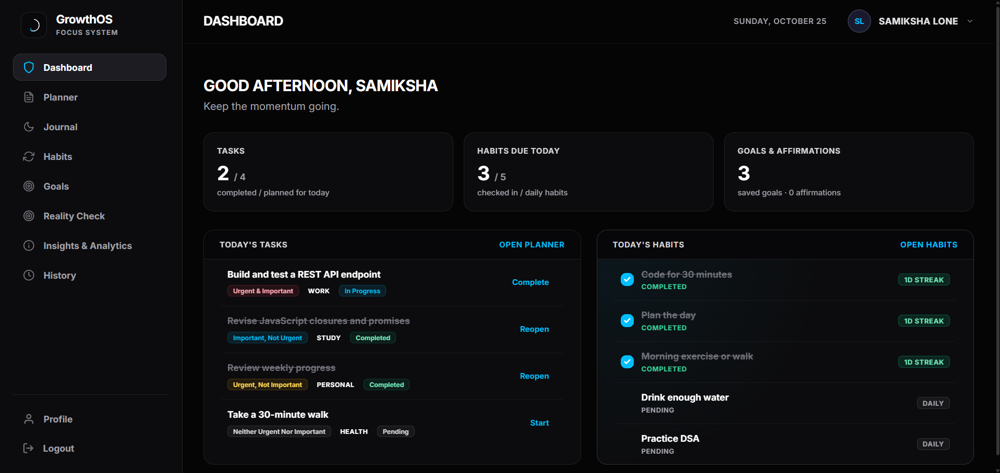
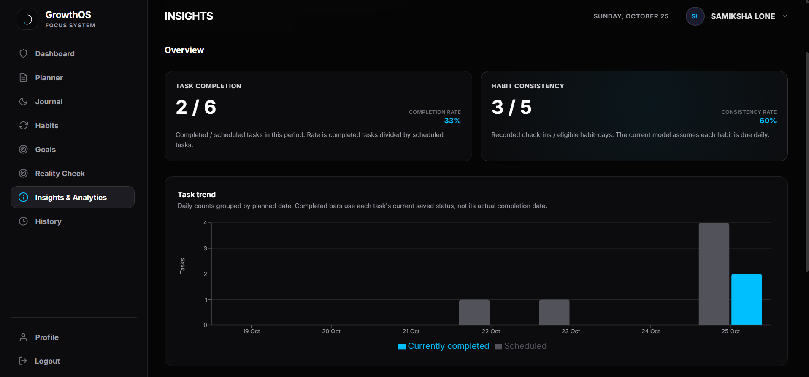
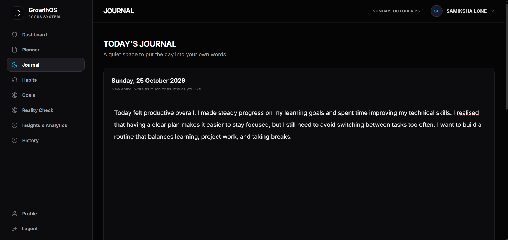

# GrowthOS

GrowthOS is a full-stack personal productivity app for planning tasks, tracking daily habits, and recording journal reflections. It brings these activities together with a dashboard and date-based productivity reports.

## Link

- **Live demo:** [growth-os-chi.vercel.app](https://growth-os-chi.vercel.app)

## Problem Statement

Tasks, routines, and personal reflections are often tracked in separate places, making it harder to review how plans relate to follow-through. GrowthOS provides one place to organize daily work, record habit check-ins and reflections, and look back at progress.

## Problem–Solution Mapping

| User problem | GrowthOS feature |
|---|---|
| Tasks are hard to prioritize and review by day. | The Planner groups dated tasks in an Eisenhower Matrix and tracks their status. |
| Habit check-ins are easy to lose track of. | Habits can be checked off daily, with completion and streak summaries. |
| Reflections are difficult to revisit. | The Journal saves dated entries with optional mood and reflection prompts. |
| It is difficult to see patterns over time. | Insights reports task, habit, and mood trends over a selected date range. |

## What Is Implemented

- **Dashboard:** Summarizes today's tasks and habit check-ins, saved goals and affirmations, and recent task and habit activity. Task status and habit check-ins can be updated from the dashboard.
- **Task planning:** Create, edit, complete, reopen, and delete tasks for a selected date. Tasks have an Eisenhower urgency/importance classification, category, status, and optional due date. Older incomplete tasks are marked missed by a scheduled backend job.
- **Habits:** Create and delete habits, record daily check-ins, and review recorded streaks and completion for today. Analytics currently treats every habit as due each day; there are no per-habit schedules.
- **Goals and affirmations:** Save and delete personal goals and affirmations. These are stored as text entries; goal completion or progress is not tracked.
- **Insights:** Review task completion, habit consistency, mood, and category trends for the last 7 days, last 30 days, or a custom range of up to 366 days. Some trend measures use a task's current saved status against its planned date rather than a separate completion timestamp.
- **Journal:** Create and edit dated entries with freeform notes and optional mood, positive moments, difficulties, and learnings. Browse and delete saved entries.
- **Authentication and account:** Register and sign in with email and password, update profile name and email, change password, sign out, and request account deletion. Account deletion removes the user's associated records.
- **History and Reality Check:** Browse filtered historical activity and compare a day's planned tasks with completed and missed tasks, including a category breakdown.

## Solution Overview

The React and TypeScript single-page application uses React Router for page navigation and Axios to call the Express REST API. Protected pages send the signed-in user's bearer token with API requests. Express routes pass requests through authentication and, where used, validation middleware before controllers call service-layer logic and Mongoose models.

MongoDB stores users and their tasks, habits, goals, reflections, and insights. Resource queries are scoped to the authenticated user. TanStack Query manages server state in the frontend, caches query results, and refreshes affected views after changes. During local development, Vite serves the frontend and the API runs separately.

## Project Highlights

- TypeScript is used across the frontend and backend, with backend code organized into routes, controllers, services, middleware, and models.
- Resource endpoints require JWT authentication; records are queried or changed in the context of the authenticated user.
- Joi validation is used for authentication and profile requests, with Mongoose schemas enforcing model constraints and a centralized API error handler.
- TanStack Query manages request state and cache invalidation across related views after mutations.
- Analytics are derived from persisted task, habit, and reflection data; date ranges are validated and capped at 366 days.
- Authentication endpoints use in-memory, per-process request limits. These limits are not shared across multiple backend instances.

## Features

- 📊 Daily dashboard for task, habit, and goal summaries
- 🗂️ Dated task planner with an Eisenhower Matrix
- 🔁 Daily habit check-ins and streak summaries
- 🎯 Saved goals and affirmations
- 📈 Date-range insights for tasks, habits, and mood
- 📓 Dated journal entries with optional reflection prompts
- 🔐 Email/password authentication and account settings
- 🕘 Activity history and daily planning review

## Screenshots

### Dashboard

Today's task and habit summaries with quick status updates.



### Insights

Task completion and habit consistency summarized over time.



### Journal

A dated journal entry with optional reflection prompts.



## Tech Stack

| Area | Technologies |
|---|---|
| Frontend | React 18, TypeScript, Vite, React Router |
| Styling and UI | Tailwind CSS, PostCSS, Framer Motion, React Icons, React Hot Toast |
| API client and server state | Axios, TanStack React Query |
| Charts | Recharts |
| Backend | Node.js, Express 5, TypeScript |
| Database and models | MongoDB, Mongoose |
| Authentication and validation | JWT, bcryptjs, Joi |
| Background scheduling | node-cron |
| Deployment configuration | Vercel SPA rewrite for the frontend; no backend hosting configuration is included in this repository |

## Installation / Setup Steps

### Prerequisites

- Node.js 20.19.0 or newer and npm
- A MongoDB database reachable by the backend, either local or hosted

### 1. Configure and run the backend

```bash
cd backend
npm install
```

Create `backend/.env` with the required database URI and a random JWT secret:

```env
MONGO_URI=mongodb://127.0.0.1:27017/growthos
JWT_SECRET=<random secret of at least 32 bytes>
PORT=5000
FRONTEND_URL=http://localhost:4173
```

`MONGO_URI` and `JWT_SECRET` are required. `PORT` defaults to `5000`; `FRONTEND_URL` is an optional comma-separated CORS allow-list (the local Vite origin is allowed by default). The backend exits if `JWT_SECRET` is missing or shorter than 32 bytes. Generate a local secret with:

```bash
node -e "console.log(require('crypto').randomBytes(32).toString('hex'))"
```

Start the development API:

```bash
npm run dev
```

### 2. Configure and run the frontend

In a second terminal:

```bash
cd frontend
npm install
npm run dev
```

Vite serves the frontend at `http://localhost:4173`. In development, the frontend defaults to `http://localhost:5000/api` for the API, so a frontend environment file is not needed for this local setup. To use another backend, create `frontend/.env.local` and set:

```env
VITE_API_BASE_URL=https://<your-backend-host>
```

The frontend appends `/api` when it is not included in the URL. For a production build, run `npm run build` from `frontend`. The backend also provides `npm run build` and `npm start` scripts; `npm start` builds the TypeScript API before starting it.

## Key Learnings

- Connecting a typed React client to a REST API with authenticated requests.
- Organizing backend behavior across route, controller, service, and model layers.
- Modeling user-owned records and scoping data access to the authenticated user.
- Coordinating server-state caching and invalidation after mutations.
- Aggregating date-based task, habit, and reflection data into report metrics.
- Designing loading, empty, validation, and error states for data-driven screens.

## Future Improvements

- Add reminders and notifications for upcoming tasks and habits.
- Explore calendar integration for better schedule management.
- Support exporting and backing up personal productivity data.
- Expand weekly and monthly productivity insights.
- Further improve the mobile experience and responsive interactions.

## License

ISC License — see [LICENSE](LICENSE) for details.

## Contact

**Developed by [Samiksha Lone](https://samiksha-lone.vercel.app/)**
